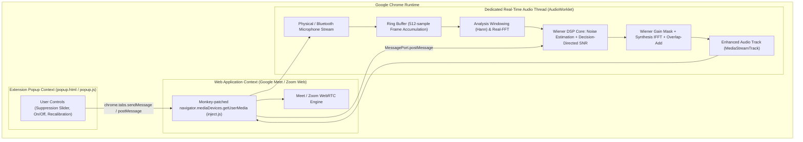
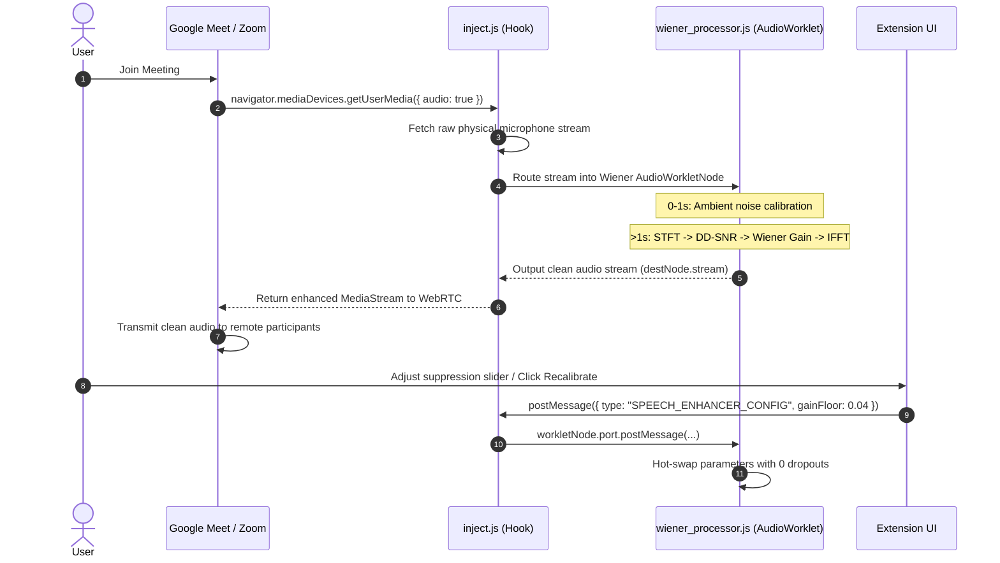

# System Architecture & Technical Specification: Pure In-Browser Real-Time Speech Enhancement

## 1. High-Level Architecture Diagram

---

## 2. Core Concepts & Mathematical Foundation

This system is built upon classical Statistical Signal Processing and Frequency-Domain Spectral Filtering.

### A. Short-Time Fourier Transform (STFT) & Overlap-Add (OLA)
Audio cannot be assumed stationary over long periods, but speech is quasi-stationary over short time windows (20–35 ms).
1. **Framing & Windowing:**
   - Frame length: $N = 512$ samples (32 ms at 16,000 Hz).
   - Hop length: $H = 256$ samples (16 ms, 50% overlap).
   - Analysis window $w(n)$: Square-root Hann window:
     $$w(n) = \sqrt{0.5 \left(1 - \cos\left(\frac{2\pi n}{N}\right)\right)}$$
   - Applying $\sqrt{w(n)}$ at analysis and $\sqrt{w(n)}$ at synthesis ensures the Perfect Reconstruction property (sum of squares equals 1).

2. **Discrete Real-to-Complex FFT:**
   - Converts time-domain frame $x(n)$ to frequency spectrum $X(k)$:
     $$X(k) = \sum_{n=0}^{N-1} x(n) w(n) e^{-j \frac{2\pi k n}{N}}, \quad k = 0, \dots, \frac{N}{2}$$

---

### B. Noise Power Spectral Density (PSD) Estimation & VAD
The observed signal $X(k)$ consists of speech $S(k)$ and additive noise $D(k)$:
$$X(k) = S(k) + D(k)$$

1. **Ambient Calibration:**
   - During the first 1 second (approx. 60 frames), the user is assumed quiet.
   - Initial noise PSD $P_n(k)$ is the average power spectrum:
     $$P_n(k) = \frac{1}{M} \sum_{m=1}^M |X_m(k)|^2$$

2. **Energy-based Voice Activity Detection (VAD):**
   - For subsequent frames, total frame energy $E_{\text{frame}} = \sum |X(k)|^2$ is compared against background noise energy $E_{\text{noise}} = \sum P_n(k)$.
   - If $E_{\text{frame}} < \text{threshold} \times E_{\text{noise}}$, the frame is classified as noise, and the noise estimate is updated via first-order recursive smoothing:
     $$P_n(k) \leftarrow \alpha_n P_n(k) + (1 - \alpha_n) |X(k)|^2 \quad (\alpha_n = 0.96)$$

---

### C. Decision-Directed a Priori SNR Estimation (Ephraim & Malah)
Conventional direct SNR estimation ($|X(k)|^2/P_n(k) - 1$) produces severe **musical noise** (random high-frequency residual tones). The **Decision-Directed (DD)** approach solves this by smoothing the estimated a priori SNR $\xi_k$ across frames:

$$\xi_k^{(m)} = \alpha_d \frac{|\hat{S}_k^{(m-1)}|^2}{P_n(k)} + (1 - \alpha_d) \max\left(\gamma_k^{(m)} - 1, 0\right)$$

Where:
- $\gamma_k^{(m)} = \frac{|X_k^{(m)}|^2}{P_n(k)}$ is the **a posteriori SNR**.
- $\hat{S}_k^{(m-1)}$ is the enhanced speech spectral magnitude from the previous frame.
- $\alpha_d = 0.98$ is the decision-directed smoothing constant.

---

### D. Parametric Wiener Gain Mask & Overlap-Add
The optimal Wiener filter gain $G(k)$ in terms of minimum mean-square error (MMSE):

$$G(k) = \frac{\xi_k}{\xi_k + \mu}$$

Where $\mu$ is the **oversubtraction factor** ($\mu \ge 1.0$).

To prevent acoustic speech distortion and harsh clipping, a configurable **gain floor** $G_{\min}$ is applied:
$$G_{\text{final}}(k) = \max\left(G(k), G_{\min}\right), \quad G_{\min} \in [0.02, 0.20]$$

1. **Filtering:** $\hat{S}(k) = G_{\text{final}}(k) \cdot X(k)$
2. **Inverse FFT (IFFT):** Transform $\hat{S}(k)$ back to time domain $\hat{s}(n)$.
3. **Synthesis Windowing & Overlap-Add:**
   $$\hat{y}(n) = \hat{y}(n) + \hat{s}(n) w(n)$$
   The first half of the synthesized hop is output immediately, preserving minimal algorithmic delay (16 ms).

---

## 3. Technology Stack & Component Breakdown

| Layer | Technology | Role & Justification |
|---|---|---|
| **Audio Processing Engine** | **Web Audio API (`AudioWorkletProcessor`)** | Runs on a dedicated, high-priority real-time audio thread separate from the DOM/JS main thread to guarantee zero glitches and sub-millisecond audio rendering. |
| **Spectral Transform** | **Pure JavaScript In-Place Radix-2 Real-FFT / IFFT** | Zero external libraries or binaries; transforms time-frequency representations natively inside the Worklet. |
| **API Interception** | **Media Capture & Streams API (`navigator.mediaDevices.getUserMedia`)** | Monkey-patched via content script injection to intercept calls from Google Meet/Zoom transparently. |
| **Extension Framework** | **Chrome Extension Manifest V3** | Modern Chrome extension platform leveraging service workers, isolated content scripts, and secure permissions. |
| **UI & State Management** | **HTML5, CSS3 (Modern Flex/Grid Dark Theme), Vanilla ES6 JS** | Lightweight popup UI with sliders for real-time gain floor parameter tuning and persistent storage via `chrome.storage.sync`. |
| **Inter-Process Communication (IPC)** | **`window.postMessage` + `AudioWorkletNode.port.postMessage`** | Passes real-time slider updates and recalibration triggers from popup &rarr; content script &rarr; audio worklet thread. |

---

## 4. End-to-End Execution Sequence

---

## 5. Performance & Operational Characteristics

- **Algorithmic Latency:** 16 ms (one hop buffer delay at 16 kHz sample rate).
- **Execution Overhead:** $< 2\%$ CPU utilization on modern multicore processors due to single-channel 512-point FFT computation on the WebAudio thread.
- **Portability:** Operates natively in any Chromium-based browser (Google Chrome, Microsoft Edge, Brave, Opera) with zero drivers, virtual audio cables, or native binaries required.
