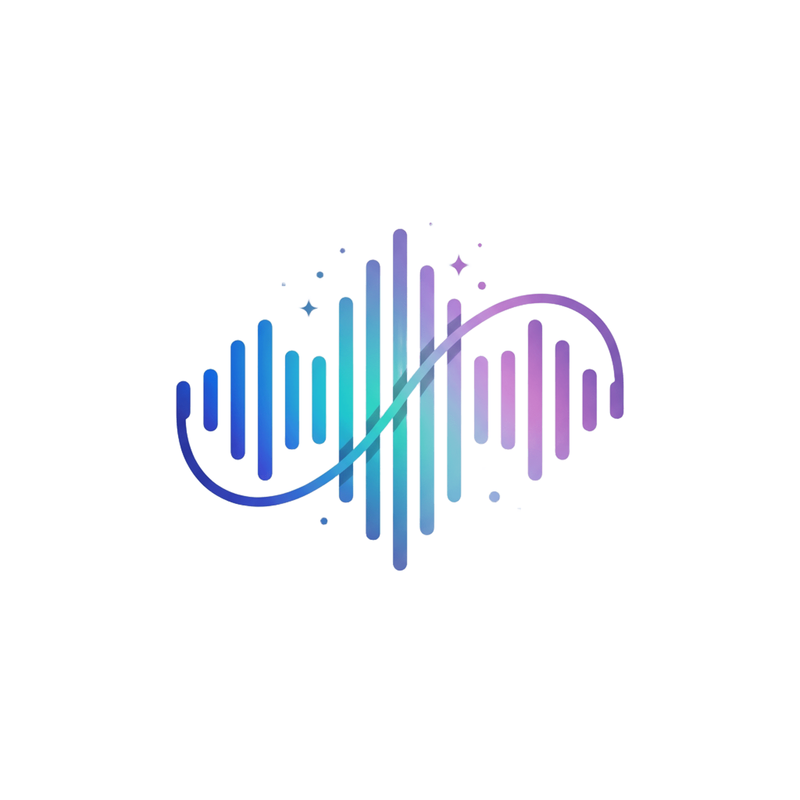

<div align="center">
  

  # Speech Enhancer for Google Meet & Zoom
  ### Pure Client-Side Real-Time Speech Noise Suppression
</div>

<br />

A lightweight, zero-latency Chrome extension that performs **real-time speech enhancement and background noise suppression** directly inside Google Meet, Zoom Web, and Microsoft Teams.

Runs **100% locally in your browser** using Web Audio API AudioWorklets. No backend servers, no cloud APIs, and no external virtual audio cable software needed.

---

## ✨ Features

- **Zero-Latency In-Browser DSP**: Employs classical short-time spectral Wiener filtering combined with the Ephraim-Malah Decision-Directed a priori SNR estimation.
- **100% Client-Side Privacy**: Audio processing is executed entirely in your browser's dedicated real-time audio thread. Zero audio data ever leaves your device.
- **Universal Compatibility**: Transparently hooks your microphone stream in Google Meet (`meet.google.com`), Zoom Web (`*.zoom.us`), and Microsoft Teams (`teams.microsoft.com`).
- **Uber-Inspired Design System**: Minimalist, responsive UI built with modern black-and-white polarity cards, 999px pill controls, and real-time suppression sliders.
- **Dynamic Recalibration**: One-click ambient noise recalibration button to adapt instantly to changing background environments (fans, AC, traffic hiss).

---

## 🚀 Quick Start (Install in Chrome)

No build tools or extra software required.

1. **Download / Clone** this repository:
   ```bash
   git clone https://github.com/your-username/realtime-speech-enhancement.git
   ```
2. Open Google Chrome and navigate to:
   ```text
   chrome://extensions/
   ```
3. Enable **Developer mode** using the toggle in the top-right corner.
4. Click **Load unpacked** in the top-left corner.
5. Select the `chrome_extension` folder from this repository:
   ```text
   realtime-speech-enhancement/chrome_extension
   ```
6. Pin the **Speech Enhancer** icon to your Chrome toolbar.

---

## 🎯 How to Use

1. Open **Google Meet** ([meet.google.com](https://meet.google.com)) or **Zoom Web**.
2. Join your meeting as usual and select your standard microphone.
3. Click the **Speech Enhancer** extension icon from your browser toolbar:
   - **Toggle On/Off**: Quickly pause or resume noise filtering at any time.
   - **Suppression Intensity**: Adjust the *Gain Floor* slider from `0.02` (aggressive noise cut) to `0.20` (mild, natural acoustic profile).
   - **Recalibrate**: Click *Recalibrate room noise* whenever ambient sounds shift (e.g. turning on an air conditioner or fan).

---

## 🔬 How It Works (Architecture & DSP)

```mermaid
flowchart LR
    Mic[Physical / Bluetooth Mic] --> Hook[getUserMedia Hook: inject.js]
    Hook --> Worklet[AudioWorklet Thread: wiener_processor.js]
    Worklet --> STFT[512-sample STFT + √Hann Window]
    STFT --> Estimator[Noise PSD & Frame VAD]
    Estimator --> SNR[Decision-Directed a Priori SNR]
    SNR --> Mask[Parametric Wiener Gain Mask]
    Mask --> IFFT[Synthesis IFFT + Overlap-Add]
    IFFT --> Meet[Clean Audio Stream -> Google Meet / Zoom WebRTC]
```



1. **Stream Hooking (`inject.js`)**:
   Monkey-patches `navigator.mediaDevices.getUserMedia` inside meeting web tabs to intercept incoming microphone tracks before WebRTC encoding.
2. **Dedicated Audio Thread (`wiener_processor.js`)**:
   Transfers the raw PCM stream into a Web Audio `AudioWorkletNode` that runs off the main JavaScript UI thread, preventing frame drops and audio glitches.
3. **Wiener Spectral Filter**:
   - Computes an in-place Real-FFT across 512-sample frames with a 50% overlap-add (OLA).
   - Tracks noise energy across frequency bins during non-speech intervals via a recursive VAD.
   - Computes an MMSE parametric Wiener attenuation mask, eliminating stationary noise (fans, hums, background hiss) with only 16 ms of algorithmic delay.

---

## 🛠️ Repository Structure

```text
├── assets/
│   └── logo/
│       ├── logo.png             # Master logo
│       └── icon*.png            # High-resolution icons (16, 32, 48, 128px)
│
├── chrome_extension/
│   ├── assets/logo/             # Packaged extension icons
│   ├── manifest.json            # Manifest V3 configuration & permissions
│   ├── popup.html               # Extension UI layout
│   ├── popup.css                # Uber-inspired design system styles & tokens
│   ├── popup.js                 # UI logic and reactive state management
│   ├── content.js               # Content script bridging messages to web pages
│   ├── inject.js                # Intercepts getUserMedia audio streams
│   ├── wiener_processor.js      # WebAudio AudioWorklet with full DSP Wiener filter
│   └── DESIGN.md                # Design tokens & UX specifications
```

---

## 🔒 Privacy & Permissions

- **`activeTab` & `storage`**: Used solely to store your preferred noise suppression slider value and send real-time configuration updates to your active meeting tab.
- **Zero Network Transmission**: The extension has no external backend dependencies and makes zero outbound network requests. All computations take place strictly on your local CPU.

---

## 📄 License

This project is open-source under the [MIT License](LICENSE).
